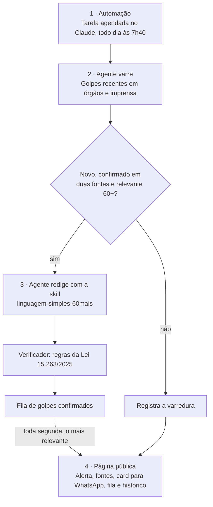

# Sentinela 60+ — Pitch do produto

| Identificação | |
| --- | --- |
| Universidade | FAAP — Fundação Armando Alvares Penteado |
| Curso | Tecnologia em Inteligência Artificial |
| Disciplina | Vibe Coding & Arquitetura de Produtos com IA (PDCP) |
| Professora | Profª Drª Eliana Loureiro |
| Aluno | Marcelo Frazão |
| Avaliação | N2, trabalho final individual, entrega em 27/11/2026 |

## Introdução

O Sentinela 60+ acompanha todo dia os golpes digitais em circulação e, toda semana, transforma o mais
importante deles num alerta curto e em linguagem simples para pessoas com 60 anos ou mais e para quem cuida
delas.

O produto foi construído com Claude para a N2 de Vibe Coding & Arquitetura de Produtos com IA (FAAP, Profª
Drª Eliana Loureiro). Ele integra os três componentes pedidos: uma skill de linguagem simples, um agente que
pesquisa e verifica, e uma automação diária que varre o noticiário e publica toda semana sem intervenção
humana.

Tudo é aberto: a skill está neste repositório público e o produto, numa página com link.

## A dor

Quem tem 60 anos ou mais já está online em massa, os golpes crescem sem parar e os alertas existentes não
falam a língua desse público.

| Indicador | Número | Fonte |
| --- | --- | --- |
| Pessoas com 60 anos ou mais | 32,1 milhões (15,8% da população) | [Censo 2022, via Agência Gov](https://agenciagov.ebc.com.br/noticias/202310/brasileiros-com-60-anos-ou-mais-superam-32-milhoes-de-pessoas-mdhc-reforca-importancia-do-cuidado-e-respeito-com-essa-faixa-etaria) |
| Pessoas 60+ que usaram internet em 2025 | 74,5% (+4,4 pontos sobre 2024) | [IBGE, PNAD Contínua TIC 2025](https://agenciadenoticias.ibge.gov.br/en/agencia-news/2184-news-agency/news/47473-proporcao-de-usuarios-da-internet-no-pais-ultrapassou-90-da-populacao-de-10-anos-ou-mais-em-2033) |
| Estelionatos registrados no país em 2025 | 2.261.055 (258 por hora; +429,8% desde 2018) | [20º Anuário Brasileiro de Segurança Pública, via Olhar Digital](https://olhardigital.com.br/2026/07/23/seguranca/o-golpe-que-mais-cresce-no-brasil-esta-no-seu-celular-entenda/) |
| Vítimas de golpe digital com mais de 60 anos (2024) | 16% das vítimas (16 a 29 anos: 27%) | [DataSenado, via Agência Senado](https://www12.senado.leg.br/noticias/infomaterias/2025/04/golpes-virtuais-aumentam-e-nao-fazem-distincao-de-idade) |
| Denúncias de violência patrimonial contra pessoas idosas em 2025 | Mais de 59 mil (+16% sobre 2024) | [Ouvidoria Nacional de Direitos Humanos, via Correio Braziliense](https://www.correiobraziliense.com.br/cidades-df/2026/07/7457568-fraudes-contra-idosos-aumentam-em-todo-o-pais.html) |
| Fraude com voz clonada por IA em São Paulo | 12+ vítimas, cerca de R$ 10 milhões | [OECD AI Incidents Monitor, maio de 2026](https://oecd.ai/en/incidents/2026-05-19-df32) |

"Violência patrimonial" inclui abusos cometidos por familiares, não só golpes digitais. Nas fontes
consultadas não há recorte nacional de estelionato digital por idade; essa é a primeira pergunta aberta do
projeto.

Os dados não mostram que pessoas 60+ caiam em mais golpes; mostram que caem em golpes diferentes. Os mais
velhos sofrem sobretudo fraudes que imitam bancos e cartões
([Agência Senado](https://www12.senado.leg.br/noticias/infomaterias/2025/04/golpes-virtuais-aumentam-e-nao-fazem-distincao-de-idade)).

Também são alvo deliberado: anúncios fraudulentos são segmentados por termos como aposentadoria, benefício
e INSS ([Agência Pública](https://apublica.org/2026/05/depois-do-eca-esta-na-hora-de-um-estatuto-do-idoso-digital/)).
É essa mira específica que justifica um alerta feito para esse público.

O problema não é falta de aviso. Bancos, Procons e polícias publicam alertas, mas eles chegam dispersos, em
linguagem institucional e sem uma ação clara.

Hipótese do produto: um alerta curto, semanal, com uma única ação e uma frase de checagem é mais lembrado e
mais repassado do que um comunicado. Validar essa hipótese com o público fica fora do escopo desta entrega.

## Inspiração: a SabedorIA

O tema nasceu da prática extensionista SabedorIA, em que estudantes da FAAP conduziram oficinas de introdução
à IA e de engenharia de prompt para pessoas idosas do Coletivo Bairro com Vida. Lá a IA era o assunto; aqui
ela é o instrumento de proteção.

A experiência serve apenas de ponto de partida: chamou a atenção para os golpes que miram pessoas idosas, um
problema público que este trabalho fundamenta em fontes jornalísticas e oficiais. Nenhum material, dado ou
entrega da SabedorIA é reutilizado, e o Coletivo não participa desta entrega.

## Propósito

Dar a quem tem 60 anos ou mais a capacidade de checar sozinho, em segundos, se uma mensagem ou ligação é
golpe. A tese é autonomia, não medo.

Cada alerta segue uma regra fixa: um golpe, um sinal para reconhecer, uma ação a tomar e uma frase de
checagem fácil de lembrar.

O que o produto não é:

- Não é central de denúncia e não substitui banco, Procon ou polícia; aponta para eles.
- Não envia mensagens automáticas a pessoas idosas. O card é repassado por alguém de confiança, por
  consentimento.
- Não promete detectar todo golpe. Promete traduzir bem os que já foram confirmados por fontes.

## Como funciona

Cada componente tem um papel distinto: a automação decide quando, o agente decide o quê e a skill decide como.

Só o golpe novo e confirmado em duas fontes entra na fila; toda segunda, o mais relevante vira o alerta da semana. Um golpe muito grave, com orientação oficial nova, pode sair antes, no máximo uma vez por semana.

## Diferenciação e critérios de sucesso

O diferencial não é ter alertas, e sim o padrão: varredura diária com publicação semanal, uma ação por alerta e linguagem simples
verificável contra uma norma pública.

| Componente | Critério de sucesso | Evidência na entrega |
| --- | --- | --- |
| Skill | 10 casos de teste aprovados no checklist do art. 5º da Lei 15.263/2025 | Pares antes/depois no repositório |
| Agente | Todo alerta com ao menos duas fontes citadas; nenhum publicado sem fonte | Fontes visíveis em cada alerta |
| Automação | Execuções diárias reais, sem intervenção humana, com ao menos duas publicações de segunda antes de 27/11 | Histórico de execuções e fila na página |
| Produto | Página pública legível no celular, com fonte grande e contraste nível AA da WCAG | Link publicado e checagem de acessibilidade |

## Fontes

- [Lei nº 15.263, de 14 de novembro de 2025 — Política Nacional de Linguagem Simples (Câmara dos Deputados)](https://www2.camara.leg.br/legin/fed/lei/2025/lei-15263-14-novembro-2025-798293-publicacaooriginal-177011-pl.html)
- [ISO 24495-1:2023 — Plain language, Part 1: Governing principles and guidelines](https://www.iso.org/standard/78907.html)
- [Golpes virtuais aumentam e não fazem distinção de idade — DataSenado (Agência Senado, abril de 2025)](https://www12.senado.leg.br/noticias/infomaterias/2025/04/golpes-virtuais-aumentam-e-nao-fazem-distincao-de-idade)
- [Depois do ECA, está na hora de um Estatuto do Idoso Digital — coluna de Natalia Viana (Agência Pública, maio de 2026)](https://apublica.org/2026/05/depois-do-eca-esta-na-hora-de-um-estatuto-do-idoso-digital/)
- [Censo 2022: brasileiros com 60 anos ou mais superam 32 milhões (Agência Gov)](https://agenciagov.ebc.com.br/noticias/202310/brasileiros-com-60-anos-ou-mais-superam-32-milhoes-de-pessoas-mdhc-reforca-importancia-do-cuidado-e-respeito-com-essa-faixa-etaria)
- [IBGE: usuários da internet passam de 90% da população de 10 anos ou mais em 2025](https://agenciadenoticias.ibge.gov.br/en/agencia-news/2184-news-agency/news/47473-proporcao-de-usuarios-da-internet-no-pais-ultrapassou-90-da-populacao-de-10-anos-ou-mais-em-2033)
- [O golpe que mais cresce no Brasil está no seu celular (Olhar Digital, 23/07/2026)](https://olhardigital.com.br/2026/07/23/seguranca/o-golpe-que-mais-cresce-no-brasil-esta-no-seu-celular-entenda/)
- [Fraudes contra idosos aumentam em todo o país (Correio Braziliense, 27/07/2026)](https://www.correiobraziliense.com.br/cidades-df/2026/07/7457568-fraudes-contra-idosos-aumentam-em-todo-o-pais.html)
- [AI-generated lawyer voice cloning used in fraud scheme in São Paulo (OECD AI Incidents Monitor)](https://oecd.ai/en/incidents/2026-05-19-df32)
