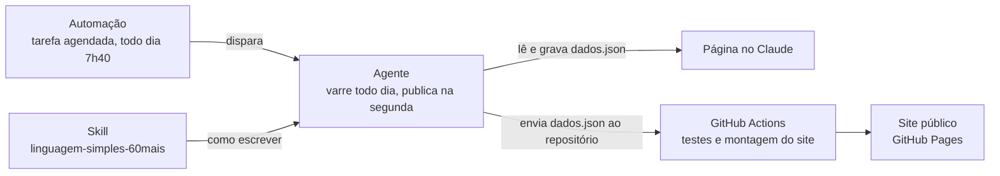

# Sentinela 60+

Um golpe digital por semana, explicado em linguagem simples para quem tem 60 anos ou mais e para quem cuida
dessas pessoas. Todo dia, um agente feito com Claude pesquisa os golpes noticiados e guarda numa fila os que
forem novos, confirmados em duas fontes independentes (uma delas órgão público, polícia, Procon ou
banco) e relevantes para esse público. Toda segunda, o mais
importante da fila vira o alerta da semana, com um texto e uma imagem prontos para o WhatsApp.

**Site público:** https://mfraza73.github.io/sentinela-60mais/ (sem login, servido da pasta [`docs/`](docs/))

**Página no Claude:** https://claude.ai/artifact/FXPh194Ln6RmBsnkLAU7m2 (onde o agente lê e grava o estado)

[](https://github.com/MFraza73/sentinela-60mais/actions/workflows/testes.yml)

| | |
| --- | --- |
| Universidade | FAAP — Fundação Armando Alvares Penteado |
| Curso | Tecnologia em Inteligência Artificial |
| Disciplina | Vibe Coding & Arquitetura de Produtos com IA (PDCP) |
| Professora | Profª Drª Eliana Loureiro |
| Aluno | Marcelo Frazão |
| Avaliação | N2, trabalho final individual, entrega em 27/11/2026 |

## Os três componentes



| Componente | O que faz | Onde está |
| --- | --- | --- |
| Skill | Escreve e revisa alertas de golpe em linguagem simples, pelo art. 5º da Lei 15.263/2025, com verificador automático | [`02-skill/`](02-skill/) |
| Agente | Varre todo dia órgãos públicos, bancos, imprensa, agências de checagem e um pacote regional de polícias e Procons; aplica 4 perguntas de decisão a cada golpe, guarda os aprovados numa fila e publica o melhor às segundas | [`03-agente/`](03-agente/) |
| Automação | Tarefa agendada do Claude que dispara o agente todo dia às 7h40, sem intervenção humana | [`04-automacao/`](04-automacao/) |
| Produto | Página com o alerta da semana, imagem e card para WhatsApp, leitura em voz alta, a fila, o histórico de execuções, o método e as correções | [`05-produto/`](05-produto/) e [`docs/`](docs/) |
| Testes | Verificador de fontes, imagem, linguagem, sincronia do mapa de fontes e coerência dos dados, rodados no GitHub a cada envio | [`testes/`](testes/) |

## Por onde começar

1. **O pitch:** [`01-pitch/pitch.md`](01-pitch/pitch.md) — a dor, a inspiração, o propósito e os critérios de sucesso.
2. **A skill:** [`02-skill/linguagem-simples-60mais/SKILL.md`](02-skill/linguagem-simples-60mais/SKILL.md).
   Os 10 casos de teste ficam em [`evals/`](02-skill/linguagem-simples-60mais/evals/), e os alertas gerados
   e as avaliações em [`02-skill/testes/`](02-skill/testes/). Para ver tudo de uma vez, baixe e abra
   `02-skill/testes/revisao-iteracao-1.html` no navegador.
3. **O agente:** [`03-agente/sentinela-60mais.md`](03-agente/sentinela-60mais.md) é a definição;
   [`03-agente/desenho-do-agente.md`](03-agente/desenho-do-agente.md) explica as decisões e a posição na matriz
   Gartner de capacidades; [`03-agente/fontes.md`](03-agente/fontes.md) é o mapa de fontes, com o papel de cada
   uma, os pacotes de busca e a situação de polícias e Procons nos 27 estados, testada com as ferramentas do
   agente; [`03-agente/execucoes/`](03-agente/execucoes/) guarda a primeira execução, com os 6
   golpes avaliados. As execuções automáticas ficam registradas na própria página do produto.
4. **A automação:** [`04-automacao/tarefa-agendada.md`](04-automacao/tarefa-agendada.md), com o texto exato que a
   tarefa envia a cada disparo.
5. **O produto:** [`05-produto/index.html`](05-produto/index.html) e [`05-produto/dados.json`](05-produto/dados.json).
   A cada execução, o agente atualiza a página no Claude e envia os dados a este repositório. O GitHub Actions
   roda os testes e, se passarem, [`05-produto/montar_site.py`](05-produto/montar_site.py) monta o site público em
   [`docs/`](docs/).
6. **Os testes:** [`testes/rodar_testes.py`](testes/rodar_testes.py) roda tudo o que pode ser checado sem
   interpretação; [`testes/casos-de-julgamento.md`](testes/casos-de-julgamento.md) guarda as decisões que dependem
   de leitura.

## Rodar os testes

```bash
pip install playwright && python -m playwright install chromium   # só para os testes da imagem
python3 testes/rodar_testes.py                                     # ou --sem-imagem, sem o Playwright
```

Os verificadores, um a um:

```bash
python3 02-skill/linguagem-simples-60mais/scripts/checar_alerta.py 03-agente/execucoes/2026-11-06-teste/alerta.md
python3 03-agente/scripts/checar_fontes.py --dados 05-produto/dados.json --golpe falso-advogado
python3 02-skill/linguagem-simples-60mais/scripts/gerar_imagem.py --dados 05-produto/dados.json --id 2026-11-06-falso-bloqueio-biometria-inss
```

Cada um aponta ERRO (impede a publicação) e AVISO (pede julgamento).

## Decisões registradas

O registro completo está em [`01-pitch/escopo-e-decisoes.md`](01-pitch/escopo-e-decisoes.md).

---

Projeto acadêmico. O Sentinela 60+ não substitui bancos, Procons ou a polícia; cada alerta mostra as fontes
de onde veio.
